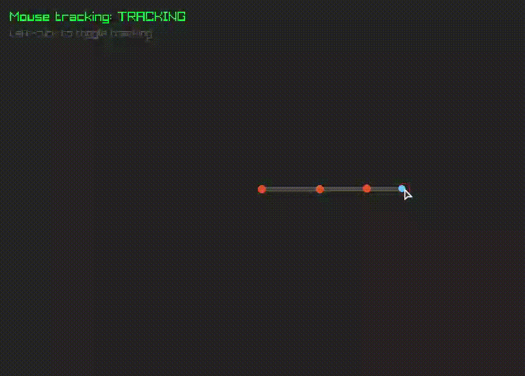
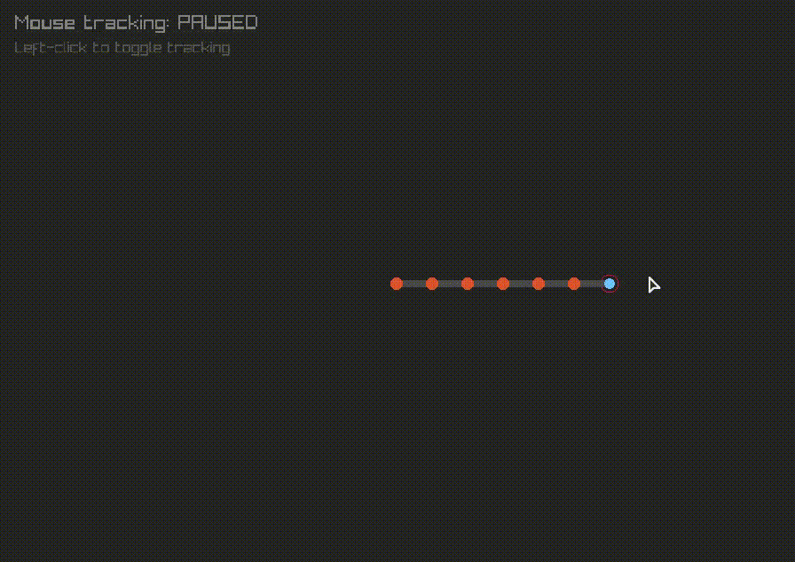

# 2D Robot Arm using Inverse Kinematics (CCD)

A simple 2D robotic arm simulation built using Python and Raylib (pyray).

The program implements **Forward Kinematics (FK)** to calculate joint positions and **Cyclic Coordinate Descent (CCD)** to adjust joint angles toward a mouse-controlled target.

Originally created as a Computer Animation assignment using three segments, with support for configurable segment counts.

## Requirements

- Python 3
- Raylib Python bindings (pyray)

Install the required package:

```bash
pip install raylib
```

## Usage

Run the Python file:

```bash
python CCD_Code.py
```

**Controls:**
- Left-click to toggle mouse tracking.
- Move the mouse to control the target while tracking is enabled.
- Press Escape to exit.

## Demonstration



